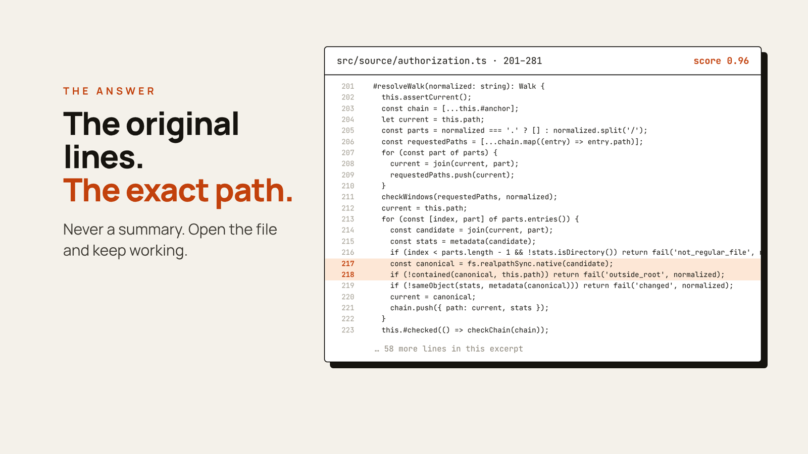

# JevGrep

[](https://www.npmjs.com/package/@nassim-arifette/jevgrep)
[](https://nodejs.org/)
[](https://modelcontextprotocol.io/)
[](LICENSE)

JevGrep finds code from a description of what it does. Ask something like *"Where is
session expiry handled?"* and it returns the source lines that answer it, with file
paths and line numbers. You can run it in a terminal or add it to Claude Code, Codex
or another MCP client, so your coding agent can look things up instead of opening
one file after another.

<p align="center">
  <a href="https://github.com/nassim-arifette/jevgrep/blob/main/docs/assets/jevgrep-demo.mp4">
    
  </a>
  <br>
  <sub><a href="https://github.com/nassim-arifette/jevgrep/blob/main/docs/assets/jevgrep-demo.mp4">Full-quality video (44 s)</a>. The results in it come from a real search on this repository.</sub>
</p>

## Why JevGrep

`grep` and `rg` work well when you know the name to search for. Often you only know
what the code is supposed to do:

- *"Where do we check that a user can access this project?"*
- *"What happens when a payment webhook arrives twice?"*
- *"Which code decides whether a file is too big to index?"*

JevGrep is built for that kind of question. Results are verbatim excerpts with
`path:start-end`, so you or your agent can open the file and carry on from there. For
an agent, one tool call stands in for a long walk through the repository, and the
answer stays within a token budget you set. Every eligible UTF-8 text file is scored,
configuration and tests included. Nothing is sent until you have authorized the
repository and had the chance to check what would leave your computer.

## Getting started

You need Node.js 24 and an API key from one of the supported providers:
[TypeSafe AI](https://typesafe.ai), [Vercel AI Gateway](https://vercel.com/ai-gateway)
or [OpenRouter](https://openrouter.ai/settings/keys).

### 1. Install

```bash
npm install -g @nassim-arifette/jevgrep
```

> The unscoped `jevgrep` package on npm belongs to a different project. Install the scoped name above; the command is still `jevgrep`.

### 2. Add your provider key (once per computer)

```bash
jevgrep init --global                       # TypeSafe AI (default)
jevgrep init --global --provider vercel     # or Vercel AI Gateway
jevgrep init --global --provider openrouter # or OpenRouter
```

The key goes in your user configuration directory, never in a repository.

### 3. Authorize a project (once per repository)

```bash
cd path/to/my-project
jevgrep init
```

JevGrep asks before it sends anything:

```text
Allow sending eligible source excerpts from this repository to Vercel AI Gateway? [y/N]
```

Answer `y` to start searching. If you would rather check first, press Enter and run
`jevgrep inspect` to see which files would be sent (more in
[Privacy](#privacy-what-leaves-your-computer)).

### 4. Ask a question

```bash
jevgrep search --query "Where is session expiry handled?"
```

Each matching excerpt is printed with its location and a relevance score. Here is a
real run on this repository:

```text
$ jevgrep search --scope src --query "Where is filesystem access controlled, and what prevents path escapes?"
jevgrep: complete
coverage: scope src | files 45/45 eligible | 170 fragments | coverage complete

4 excerpts

src/source/authorization.ts:201-281 score 0.96
  #resolveWalk(normalized: string): Walk {
    this.assertCurrent();
    ...
      const canonical = fs.realpathSync.native(candidate);
      if (!contained(canonical, this.path)) return fail('outside_root', normalized);
    ...

src/cli-args.ts:57-108 score 0.95
...
```

<p align="center">
  
</p>

## Everyday use

```bash
# Look only in some folders
jevgrep search --query "How are permissions checked?" --scope src --scope tests

# Machine-readable JSON for scripts and agents
jevgrep search --query "Where is the cache invalidated?" --json

# Long, multi-line question
jevgrep search --query-file question.txt

# Check your setup without sending anything
jevgrep doctor

# See what a search would scan and roughly what it would cost
jevgrep inspect
```

You can run JevGrep from any folder inside an authorized project. Scores and file
preparation are cached outside the repository, so repeated searches cost less and
finish sooner; `jevgrep cache clear` resets the cache.

If you already know the function name or the exact string, `rg` will be quicker.

## Connect your coding agent

JevGrep includes a local [MCP](https://modelcontextprotocol.io/) server with one tool,
`semantic_search_code`. The agent sends a question and gets the same excerpts the CLI
would print.

Authorize the repository with `jevgrep init` first. It prints the absolute path of the
project profile, which goes in the commands below. Each server handles one repository.

<details open>
<summary><b>Claude Code</b></summary>

```bash
claude mcp add --transport stdio jevgrep -- jevgrep mcp --config "/absolute/path/to/config.json"
```

Check it with `claude mcp get jevgrep`, or `/mcp` inside Claude Code.
See the [Claude Code MCP documentation](https://code.claude.com/docs/en/mcp).
</details>

<details>
<summary><b>Codex</b></summary>

Add to your Codex `config.toml`:

```toml
[mcp_servers.jevgrep]
command = "jevgrep"
args = ["mcp", "--config", "/absolute/path/to/config.json"]
tool_timeout_sec = 360
```

See the [Codex MCP documentation](https://developers.openai.com/codex/mcp).
</details>

<details>
<summary><b>Any other MCP client</b></summary>

For clients that use an `mcpServers` JSON configuration:

```json
{
  "mcpServers": {
    "jevgrep": {
      "command": "jevgrep",
      "args": ["mcp", "--config", "/absolute/path/to/config.json"]
    }
  }
}
```

On Windows, if the client cannot start the `jevgrep` command, use the absolute paths of
`node.exe` and the installed `dist/cli.js`
([how](docs/install-guide.md#connect-an-mcp-client)).
</details>

On a large repository a search can take up to 5 minutes, so set the client's tool
timeout to about 6 minutes. Keep API keys out of MCP configuration files. When the
client runs as the same user, it picks up the key saved by `jevgrep init --global`.

## Privacy: what leaves your computer

JevGrep reads your files locally. The provider you chose does the scoring, so each
search sends it:

- the eligible source fragments of the authorized repository;
- your question;
- repository-relative paths and the name of the enclosing symbol, when there is one.

Line numbers stay on your machine: they are not needed to judge an excerpt, and
leaving them out lets the cache keep the score of a function that only moved.

JevGrep leaves out `.env` files, common credential files, dependencies, build output,
generated and minified files, and files that look like they contain secrets. It
follows `.gitignore`, plus a `.jevgrepignore` file it creates for your own
exclusions. It does not follow links, and your API key never appears in a request
body, a result or the cache.

Secret detection will miss things sometimes. Run `jevgrep inspect` before your first
search and add anything sensitive to `.jevgrepignore`. Whatever the provider receives
is covered by its own privacy and retention policies.

## Providers

| Provider          | Setup                                         | Model                 |
| ----------------- | --------------------------------------------- | --------------------- |
| TypeSafe AI       | `jevgrep init --global --provider typesafe`   | `jev-1.13.0` (pinned) |
| Vercel AI Gateway | `jevgrep init --global --provider vercel`     | `typesafe-ai/jev`     |
| OpenRouter        | `jevgrep init --global --provider openrouter` | `typesafe/jev-1.13`   |

The environment variables `TYPESAFE_API_KEY`, `AI_GATEWAY_API_KEY` and
`OPENROUTER_API_KEY` override saved keys, which is useful in CI. To move a project to
another provider, run the global setup for that provider, then
`jevgrep init --provider <name>` inside the project. The
[reference](docs/reference.md#providers) lists each provider's validation status and
API details.

## Troubleshooting

| Message or symptom | What to do |
| --- | --- |
| `jevgrep: command not found` | check that npm's global `bin` folder is on your `PATH` |
| `REMOTE_DISABLED` | you have not allowed remote evaluation yet: run `jevgrep inspect`, then rerun `jevgrep init` and answer `y` |
| `CREDENTIAL_MISSING` | run `jevgrep init --global`, or set the provider's environment variable |
| `PROVIDER_AUTH` | check the key and that it has access to the Jev model |
| No result, `no_score_above_threshold` | rephrase the question or widen `--scope`; it does not prove the code is absent |
| MCP tool times out | raise the client timeout to about 6 minutes |

The [installation guide](docs/install-guide.md#troubleshooting) covers more cases.
Exit codes: `0` complete, `2` invalid request or configuration, `3` partial result,
`4` failure, `130` interrupted.

## Learn more

- [Installation and configuration guide](docs/install-guide.md): manual profiles, limits, cost caps, retries and Windows notes
- [Reference](docs/reference.md): providers, JSON output, cache policy, request batching and development
- [Benchmarks](benchmarks/README.md): retrieval quality and performance
- [Report an issue](https://github.com/nassim-arifette/jevgrep/issues)

## Contributing

```bash
git clone https://github.com/nassim-arifette/jevgrep.git
cd jevgrep
npm ci
npm run verify   # type check, offline tests, build and smoke checks
npm link         # use your checkout as the global `jevgrep` command
```

The test suite runs offline and needs no provider key.

## License

[MIT](LICENSE)
