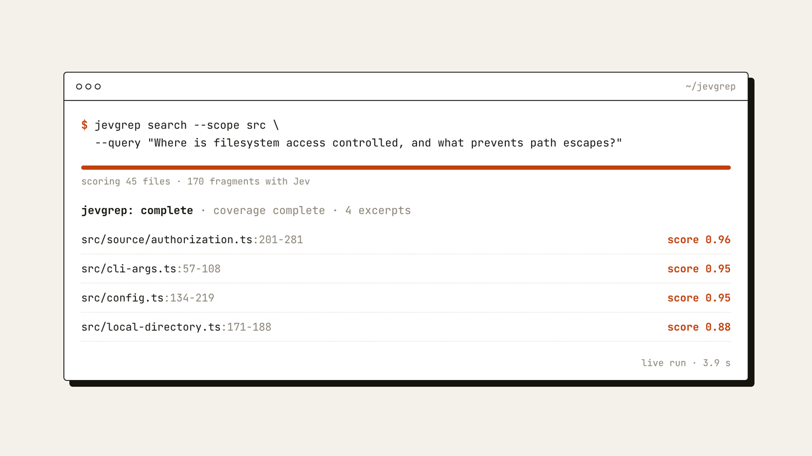

# JevGrep

[](https://www.npmjs.com/package/@nassim-arifette/jevgrep)
[](https://nodejs.org/)
[](https://modelcontextprotocol.io/)
[](LICENSE)

**Find code by what it does, not by what it is called.**

Ask a question in plain English, such as *“Where is session expiry handled?”*, and
JevGrep returns the exact source lines that answer it, with file paths and line
numbers. Use it from your terminal, or plug it into Claude Code, Codex or any MCP
client so your coding agent stops opening file after file to find its way around.

<p align="center">
  <a href="https://github.com/nassim-arifette/jevgrep/blob/main/docs/assets/jevgrep-demo.mp4">
    
  </a>
  <br>
  <sub>▶ <a href="https://github.com/nassim-arifette/jevgrep/blob/main/docs/assets/jevgrep-demo.mp4">Watch the 45-second demo</a>. Every result shown comes from a real search on this repository.</sub>
</p>

## Why JevGrep

`grep` and `rg` are perfect when you know the name to search for. Most of the time,
you only know the behaviour:

- *“Where do we check that a user can access this project?”*
- *“What happens when a payment webhook arrives twice?”*
- *“Which code decides whether a file is too big to index?”*

JevGrep answers these questions directly:

- **Original code, never a summary.** Results are verbatim excerpts with `path:start-end`, so you or your agent can open the file and keep going.
- **Less context for agents.** One tool call replaces a long exploration of the repository; the answer fits a token budget you choose.
- **Whole repository, any language.** Every eligible UTF-8 text file is scored, including configuration and tests, not just a pre-filtered shortlist.
- **You stay in control.** Nothing is sent anywhere until you authorize a repository and review what would leave your computer.

## Get started in 2 minutes

You need **Node.js 24** and an API key from one of the supported providers:
[TypeSafe AI](https://typesafe.ai), [Vercel AI Gateway](https://vercel.com/ai-gateway)
or [OpenRouter](https://openrouter.ai/settings/keys).

**1. Install**

```bash
npm install -g @nassim-arifette/jevgrep
```

> The unscoped `jevgrep` package on npm is a different project. Install the scoped name above; the command is still `jevgrep`.

**2. Add your provider key** (once per computer)

```bash
jevgrep init --global                       # TypeSafe AI (default)
jevgrep init --global --provider vercel     # or Vercel AI Gateway
jevgrep init --global --provider openrouter # or OpenRouter
```

The key is stored in your user configuration directory, never in a repository.

**3. Authorize a project** (once per repository)

```bash
cd path/to/my-project
jevgrep init
```

JevGrep asks before anything leaves your computer:

```text
Allow sending eligible source excerpts from this repository to Vercel AI Gateway? [y/N]
```

Answer `y` to search right away. Not sure yet? Press Enter, then run `jevgrep inspect`
to see exactly which files would be sent (see [Privacy](#privacy-what-leaves-your-computer)).

**4. Ask a question**

```bash
jevgrep search --query "Where is session expiry handled?"
```

JevGrep prints every matching excerpt with its location and a relevance score.
A real run on this repository:

```text
$ jevgrep search --scope src --query "Where is filesystem access controlled, and what prevents path escapes?"
jevgrep: complete
coverage: scope src | files 45/45 eligible | 170 fragments | coverage complete

4 excerpts

src/source/authorization.ts:201-281 score 0.96
  #resolveWalk(normalized: string): Walk {
    this.assertCurrent();
    ...
      const canonical = fs.realpathSync.native(candidate);
      if (!contained(canonical, this.path)) return fail('outside_root', normalized);
    ...

src/cli-args.ts:57-108 score 0.95
...
```

<p align="center">
  
</p>

## Everyday use

```bash
# Look only in some folders
jevgrep search --query "How are permissions checked?" --scope src --scope tests

# Machine-readable JSON for scripts and agents
jevgrep search --query "Where is the cache invalidated?" --json

# Long, multi-line question
jevgrep search --query-file question.txt

# Check your setup without sending anything
jevgrep doctor

# See what a search would scan and roughly what it would cost
jevgrep inspect
```

Run JevGrep from anywhere inside an authorized project, including subfolders.
Repeat searches are faster and cheaper: scores and file preparation are cached outside
the repository (`jevgrep cache clear` resets them).

**Tip:** if you already know the exact function name or string, `rg` is faster.
Use JevGrep when you know *what the code does* but not *where it is*.

## Connect your coding agent

JevGrep ships a local [MCP](https://modelcontextprotocol.io/) server with a single tool,
`semantic_search_code`. Your agent calls it with a question and gets back the same
excerpts as the CLI.

First authorize the repository with `jevgrep init`. It prints the absolute path of the
project profile; use that path below. One server serves one repository.

<details open>
<summary><b>Claude Code</b></summary>

```bash
claude mcp add --transport stdio jevgrep -- jevgrep mcp --config "/absolute/path/to/config.json"
```

Check it with `claude mcp get jevgrep`, or `/mcp` inside Claude Code.
See the [Claude Code MCP documentation](https://code.claude.com/docs/en/mcp).
</details>

<details>
<summary><b>Codex</b></summary>

Add to your Codex `config.toml`:

```toml
[mcp_servers.jevgrep]
command = "jevgrep"
args = ["mcp", "--config", "/absolute/path/to/config.json"]
tool_timeout_sec = 360
```

See the [Codex MCP documentation](https://developers.openai.com/codex/mcp).
</details>

<details>
<summary><b>Any other MCP client</b></summary>

For clients that use an `mcpServers` JSON configuration:

```json
{
  "mcpServers": {
    "jevgrep": {
      "command": "jevgrep",
      "args": ["mcp", "--config", "/absolute/path/to/config.json"]
    }
  }
}
```

On Windows, if the client cannot start the `jevgrep` command, use the absolute paths of
`node.exe` and the installed `dist/cli.js`
([how](docs/install-guide.md#connect-an-mcp-client)).
</details>

A search can take up to 5 minutes on a large repository, so give the tool call a
client timeout of about 6 minutes. Never put API keys in MCP configuration files:
the client reuses the key saved by `jevgrep init --global` when it runs as the same user.

## Privacy: what leaves your computer

JevGrep reads your files locally. Scoring is done by the provider you chose, so a search
sends it:

- the eligible source fragments of the authorized repository;
- your question;
- repository-relative paths and line ranges.

Before that, JevGrep:

- skips `.env` files, common credential files, dependencies, build output, generated and minified files, and files that look like they contain secrets;
- respects `.gitignore` and a `.jevgrepignore` file it creates for your own exclusions;
- never follows links, and never puts your API key in a request body, result or cache.

Secret detection cannot be perfect: run `jevgrep inspect` before your first search and
add anything sensitive to `.jevgrepignore`. The provider's own privacy and retention
policies apply to what it receives.

## Providers

| Provider          | Setup                                         | Model                 |
| ----------------- | --------------------------------------------- | --------------------- |
| TypeSafe AI       | `jevgrep init --global --provider typesafe`   | `jev-1.13.0` (pinned) |
| Vercel AI Gateway | `jevgrep init --global --provider vercel`     | `typesafe-ai/jev`     |
| OpenRouter        | `jevgrep init --global --provider openrouter` | `typesafe/jev-1.13`   |

Environment variables `TYPESAFE_API_KEY`, `AI_GATEWAY_API_KEY` and `OPENROUTER_API_KEY`
take priority over saved keys, which is handy in CI. To switch an existing project to
another provider, run the global setup for it, then `jevgrep init --provider <name>` in
the project. Validation status and API details for each provider are in the
[reference](docs/reference.md#providers).

## Troubleshooting

| Message or symptom | What to do |
| --- | --- |
| `jevgrep: command not found` | check that npm's global `bin` folder is on your `PATH` |
| `REMOTE_DISABLED` | you have not allowed remote evaluation yet: run `jevgrep inspect`, then rerun `jevgrep init` and answer `y` |
| `CREDENTIAL_MISSING` | run `jevgrep init --global`, or set the provider's environment variable |
| `PROVIDER_AUTH` | check the key and that it has access to the Jev model |
| No result, `no_score_above_threshold` | rephrase the question or widen `--scope`; it does not prove the code is absent |
| MCP tool times out | raise the client timeout to about 6 minutes |

More cases are covered in the [installation guide](docs/install-guide.md#troubleshooting).
Exit codes: `0` complete, `2` invalid request or configuration, `3` partial result,
`4` failure, `130` interrupted.

## Learn more

- [Installation and configuration guide](docs/install-guide.md): manual profiles, limits, cost caps, retries, Windows notes
- [Reference](docs/reference.md): providers, JSON output, cache policy, request batching, development
- [Benchmarks](benchmarks/README.md): retrieval quality and performance measurements
- [Report an issue](https://github.com/nassim-arifette/jevgrep/issues)

## Contributing

```bash
git clone https://github.com/nassim-arifette/jevgrep.git
cd jevgrep
npm ci
npm run verify   # type check, offline tests, build and smoke checks
npm link         # use your checkout as the global `jevgrep` command
```

The test suite runs offline and needs no provider key.

## License

[MIT](LICENSE)
